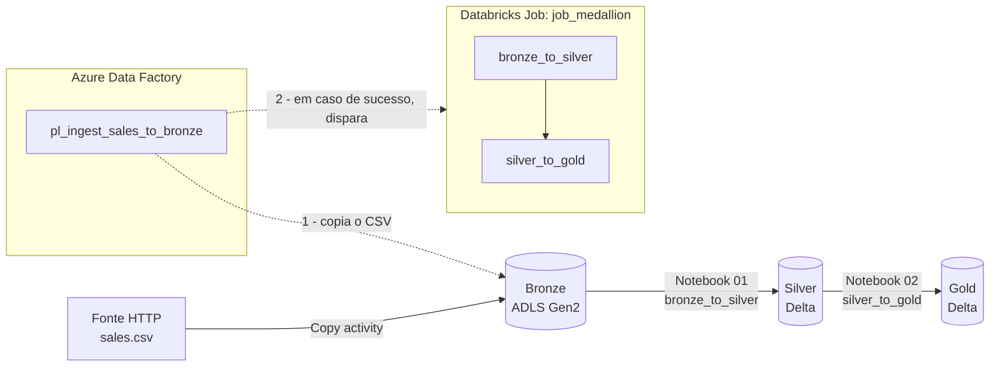
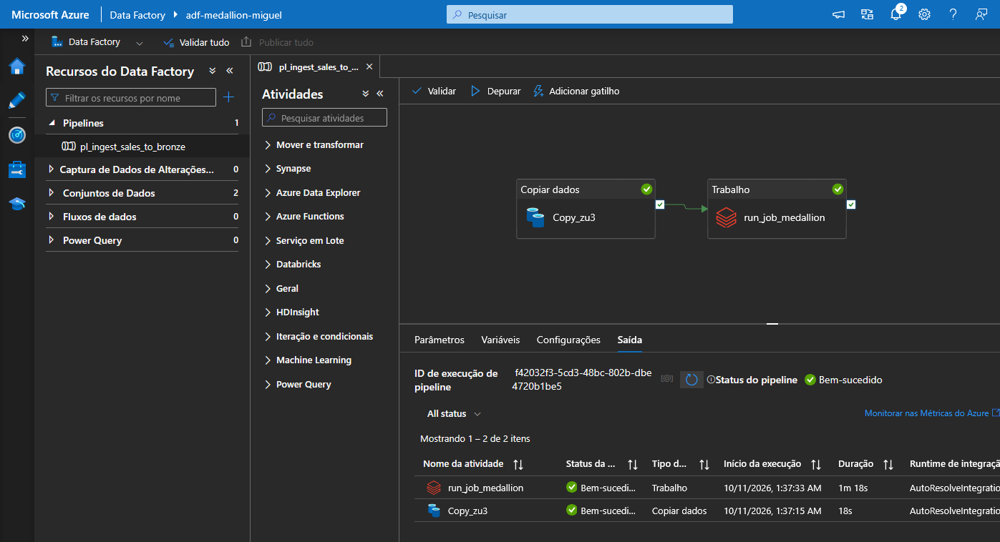
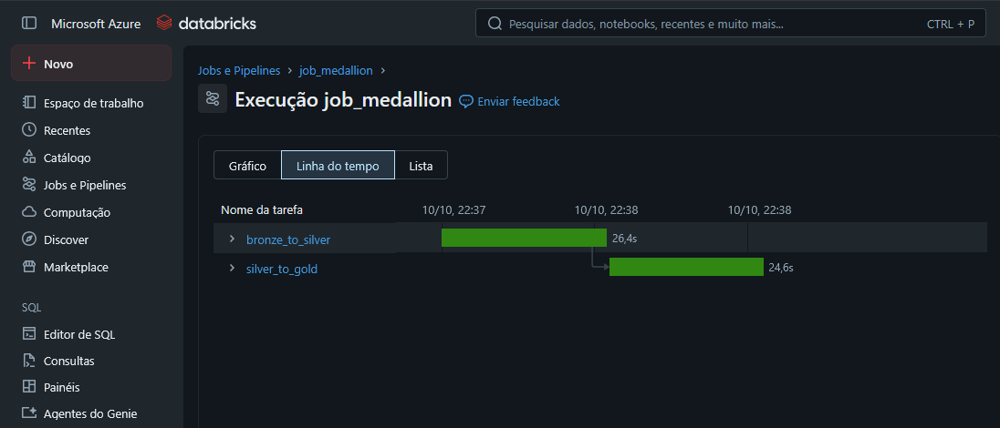
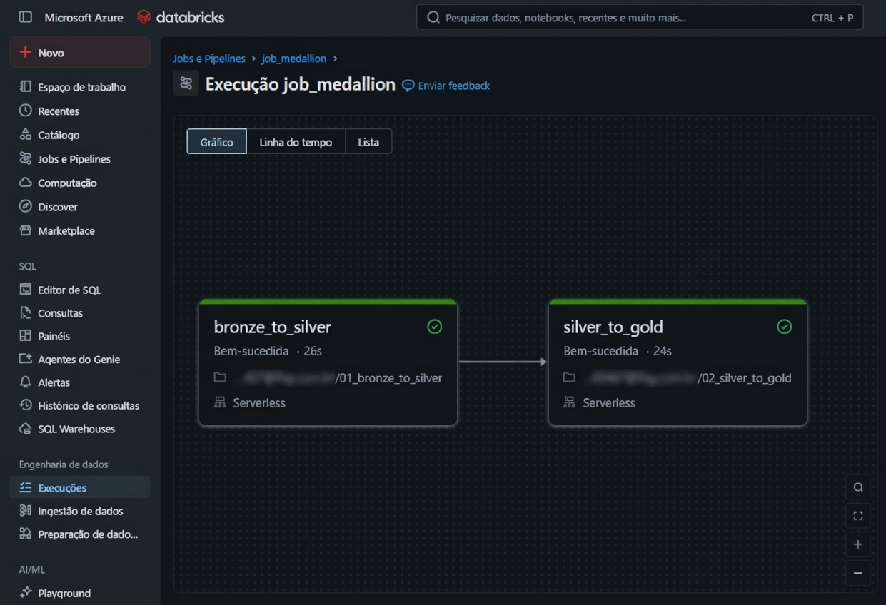
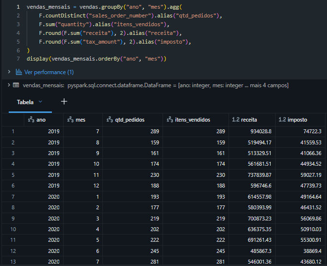
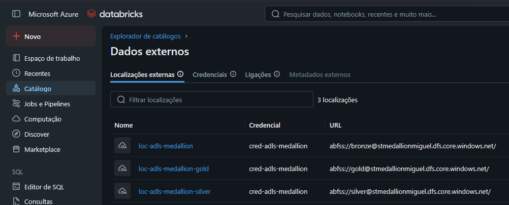
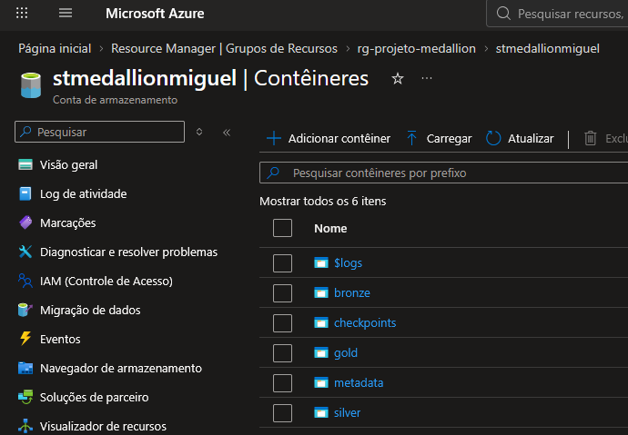

# Podium Data: Pipeline Medallion no Azure + Databricks

> Pipeline ELT de ponta a ponta, orquestrado pelo Azure Data Factory, 
> que ingere um CSV de vendas e o refina em três camadas (Bronze → Silver → Gold) usando
> Databricks, Delta Lake e Unity Catalog. Projeto de portfólio de Engenharia de Dados.


---

## Visão geral

| Item              | Detalhe                                                                                                             |
|-------------------|---------------------------------------------------------------------------------------------------------------------|
| Objetivo          | Construir um pipeline ELT funcional, orquestrado e documentado, cobrindo ingestão, transformação e camada analítica |
| Arquitetura       | Medallion (Bronze / Silver / Gold)                                                                                  |
| Abordagem         | ELT: o dado bruto é carregado primeiro e transformado depois, dentro do Databricks                                  |
| Dados             | CSV público de vendas da Microsoft (~3,16 MiB, 32.718 linhas após limpeza, jul/2019 a dez/2021)                     |
| Execução completa | ~1m35s: cópia ~18s + Job do Databricks ~1m18s (as duas tarefas somam ~51s; o restante é a partida da computação)    |

## Estrutura do Repositório
```text
azure-databricks-medallion-pipeline/
├── README.md
├── DECISOES_E_APRENDIZADOS.md
├── .gitignore
├── notebooks/
│   ├── 01_bronze_to_silver.py
│   └── 02_silver_to_gold.py
├── adf/
│   └── pl_ingest_sales_to_bronze.json
├── databricks/
│   └── job_medallion.json
└── docs/
    └── img/
        └── as 6 imagens
```

## Arquitetura




**Fluxo de orquestração:** o pipeline `pl_ingest_sales_to_bronze` do ADF tem duas atividades encadeadas. Primeiro, `Copy_zu3` copia o CSV da fonte HTTP para o container `bronze`. Se a cópia terminar com sucesso, a atividade `run_job_medallion` dispara o Job `job_medallion` no Databricks, que executa duas tarefas serverless em sequência.

## Camadas

### Bronze: dado bruto
- Container `bronze` no ADLS Gen2 (`stmedallionmiguel`, namespace hierárquico habilitado).
- Guarda o `sales.csv` exatamente como veio da fonte, sem transformação.

### Silver: dado limpo
Notebook `01_bronze_to_silver` (~26s no Job):
- verificação de valores nulos;
- remoção de duplicatas;
- renomeação de colunas para `snake_case`;
- padronização de textos.

Resultado gravado como tabela **Delta** (32.718 linhas).

### Gold: dado pronto para análise
Notebook `02_silver_to_gold` (~24s no Job) gera três tabelas agregadas:

| Tabela               | Linhas | Granularidade                                                         |
|----------------------|--------|-----------------------------------------------------------------------|
| `vendas_mensais`     | 30     | Por ano e mês: `qtd_pedidos`, `itens_vendidos`, `receita`, `imposto`  |
| `vendas_por_produto` | 130    | Por item: `qtd_pedidos`, `unidades_vendidas`, `receita`               |
| `vendas_por_cliente` | 12.427 | Por e-mail: `cliente`, `qtd_pedidos`, `unidades_compradas`, `receita` |

## Stack

| Camada        | Tecnologia                                                              |
|---------------|-------------------------------------------------------------------------|
| Armazenamento | Azure Data Lake Storage Gen2                                            |
| Orquestração  | Azure Data Factory (pipeline, linked services, atividade Job)           |
| Processamento | Azure Databricks Premium, compute serverless, PySpark                   |
| Governança    | Unity Catalog, Storage Credential, External Locations, Access Connector |
| Formato       | Delta Lake (Parquet)                                                    |
| Custos        | Azure Cost Management, orçamento com alertas                            |

## Recursos no Azure

| Recurso               | Nome                                                                                                  |
|-----------------------|-------------------------------------------------------------------------------------------------------|
| Resource Group        | `rg-projeto-medallion` (East US)                                                                      |
| Storage Account       | `stmedallionmiguel` (containers: `bronze`, `silver`, `gold`, `checkpoints`, `metadata`)               |
| Data Factory          | `adf-medallion-miguel`                                                                                |
| Workspace Databricks  | `dbw-medallion-miguel`                                                                                |
| Access Connector      | `ac-medallion-miguel` (papel Storage Blob Data Contributor no storage)                                |
| Storage Credential    | `cred-adls-medallion`                                                                                 |
| External Locations    | `loc-adls-medallion` (bronze), `loc-adls-medallion-silver` (silver), `loc-adls-medallion-gold` (gold) |
| Linked services (ADF) | `ls_http_sales_source`, `ls_adls_bronze`, `ls_databricks_medallion`                                   |
| Job Databricks        | `job_medallion` (tarefas `bronze_to_silver` → `silver_to_gold`)                                       |

## Como funciona o Job

- Duas tarefas de notebook em compute **serverless** (dimensionamento automático), encadeadas: `silver_to_gold` depende de `bronze_to_silver` e só roda se todas as dependências forem bem-sucedidas.
- Ambiente de notebook, sem parâmetros.
- Sem novas tentativas automáticas.
- **Desempenho otimizado ativado** (ver seção de problemas resolvidos).

## Problemas resolvidos

Os desafios abaixo foram resolvidos durante o projeto. Detalhes em [`DECISOES_E_APRENDIZADOS.md`](DECISOES_E_APRENDIZADOS.md).

1. **Job 10x mais lento que o notebook.** O mesmo código levava 1 a 2 s por célula no notebook e 4+ minutos no Job. Ativar o modo de *desempenho otimizado* reduziu o Job de ~12 min para ~1m16s.
2. **Falha de autenticação do ADF no Databricks.** A identidade gerenciada retornou erro 9512 (*User not authorized*). Solução adotada: token de acesso pessoal com escopo `jobs` no linked service.
3. **Credencial apontando para recurso antigo.** Ao recriar o workspace, a Storage Credential continuou apontando para o conector anterior e precisou ser atualizada para o novo Access Connector.
4. **Quotas de VM no Azure for Students.** Solução: usar compute serverless em vez de clusters manuais.

## Custos

Projeto executado na conta Azure for Students. Em outubro de 2026, o gasto total foi de aproximadamente **US$ 10,72 (≈ R$ 54)**, cerca de 11% do crédito de US$ 100, concentrado em Databricks (US$ 10,69); o Data Factory somou US$ 0,02, o Storage menos de US$ 0,01 e a transferência de dados US$ 0,00. O gasto se concentrou nos dias de desenvolvimento e depuração (9 e 10 de outubro) e não cresceu depois, com o projeto parado. Um orçamento mensal de US$ 15 com alertas em 25%, 50%, 75%, 90% e 100% foi configurado.

## Limitações e próximos passos

- **Token do ADF expira em 30 dias.** Para uso contínuo, o ideal é migrar para autenticação sem token (identidade gerenciada com permissão adequada) ou guardar o token no Azure Key Vault.
- **Sem gatilho agendado.** O pipeline roda sob demanda; um gatilho de agenda pode ser adicionado.
- **Sem testes automatizados de qualidade de dados** nem CI/CD.
- **Sem camada de consumo** (dashboard ou BI) sobre as tabelas Gold.

## Evidências

### Orquestração (Azure Data Factory)
O pipeline `pl_ingest_sales_to_bronze` copia o CSV para o Bronze (18s) e, em seguida, dispara o Job do Databricks (1m18s). Ambas as atividades terminaram com sucesso.



### Processamento (Databricks)
O Job `job_medallion` executa `bronze_to_silver` (26,4s) e `silver_to_gold` (24,6s) em sequência, em compute serverless.





> **Por que 1m18s no ADF e ~51s no Databricks?** O ADF mede a atividade inteira, incluindo o disparo do Job e a partida da computação; as tarefas medem só a execução dos notebooks. Os horários também diferem entre as telas (ADF em UTC, Databricks em horário de Brasília), mas é a mesma execução.

### Camada Gold
Resultado do notebook `02_silver_to_gold`: tabela `vendas_mensais`, com 30 meses de vendas (jul/2019 a dez/2021).



### Governança (Unity Catalog)
Três External Locations (bronze, silver e gold) acessam o ADLS Gen2 pela Storage Credential `cred-adls-medallion`, sem chaves no código.



### Armazenamento (ADLS Gen2)
Containers `bronze`, `silver`, `gold`, `checkpoints` e `metadata` na conta `stmedallionmiguel` (o `$logs` é um container de sistema do Azure).



## Autor

**Miguel Marcelo Alves Ramos de Oliveira**: estudante de Ciência da Computação (FIAP), com foco em Engenharia de Dados e IA/ML.

- GitHub: [Miguel-Marcelo-Oliveira](https://github.com/Miguel-Marcelo-Oliveira)
- LinkedIn: [Miguel Marcelo de Oliveira](https://www.linkedin.com/in/miguel-marcelo-de-oliveira-85a261235/)
